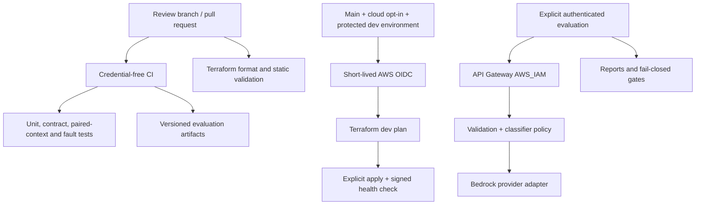

# Issue Classification Pipeline

A pipeline-first AI quality engineering learning project: GitHub Actions, Terraform, a small Bedrock-backed classifier, and deterministic synthetic evaluation with multi-turn scenarios. This is a private starter project, not a production system or evidence of prior production ownership.

## Start here

The first implementation is an executable learning slice, not every item in the original build prompt. Read [status and deferred work](docs/status.md) before interpreting any successful test or score.

- [Original prompt and notes in Phoenix Tracker](https://github.com/multi-byte-pixel/phoenix-tracker/blob/main/docs/interview-prep/ai-testing-poc/issue-classification-prompt.md): project scope and design rationale.
- [Architecture](docs/architecture.md): control plane, data plane, trust boundaries, and flow.
- [Evaluation methodology](docs/evaluation-methodology.md): denominators, paired contexts, and limitations.
- [Operational runbook](docs/operational-runbook.md): prerequisites, approved cloud commands, costs, and teardown.
- [Threat model](docs/threat-model.md): implemented controls versus remaining risks.

AWS provisioning and paid inference are not authorized merely by creating this repository. Keep cloud workflows disabled until account configuration, IAM, environment protections, costs, and the plan have been reviewed.

## Run without AWS

Use Python 3.12, `uv` 0.10.12, and GNU Make. Every command below is credential-free; the fake classifier is a deterministic test double, not an LLM.

```bash
git clone https://github.com/multi-byte-pixel/issue-classification-pipeline.git
cd issue-classification-pipeline
git switch feat/pipeline-starter  # while the starter PR is awaiting review
make setup
make lint
make test
make evaluate-local
make gate-demo
```

`evaluate-local` writes `report.json`, `summary.md`, `metrics.csv`, and `junit.xml` under `artifacts/evaluation/`. `gate-demo` succeeds only if an intentionally broken output makes the evaluation CLI exit with code 1.

## Pipeline first



## Cloud execution is disabled by default

Nothing in PR CI deploys infrastructure or calls Bedrock. No schedule, cloud role, repository secret, account configuration, production environment, or destructive workflow is enabled by this starter.

Before setting `CLOUD_ENABLED=true`, follow the [bootstrap prerequisites](infra/environments/bootstrap/README.md), configure the protected `dev` environment, review account-specific IAM, approve costs, and review a dev plan. The runbook enumerates the required variables and remaining deployment validation.

## Repository map

| Directory | Responsibility |
|---|---|
| `.github/workflows/` | Offline CI, static Terraform validation, manual deployment/evaluation, fail-closed teardown stub |
| `infra/environments/dev/` | IAM-authenticated API, Lambda, logging, private artifacts |
| `infra/environments/bootstrap/` | Account-admin prerequisites, not automated IAM bootstrap |
| `infra/environments/prod/` | Non-deployable production boundary |
| `src/event_classifier/` | Contracts, provider interface, fake and Bedrock adapters, fallback, HTTP boundary |
| `evaluation/` | Seeded fixtures, local/SigV4 runners, metrics, gates, reporters |
| `tests/` | Offline software tests and explicitly skipped live test |
| `scripts/` | Locked Linux Lambda packaging and signed health check |

## Interview framing

This project demonstrates how to separate system correctness from model behavior, start with delivery and test infrastructure, and preserve evidence without calling a synthetic result a production benchmark. Present any Bedrock, IAM, or deployed-API behavior as unverified until an approved real deployment has been exercised.
