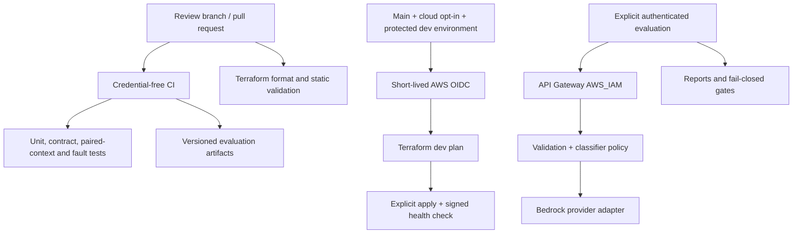

# Issue Classification Pipeline

An AI quality engineering project that builds the delivery and evaluation pipeline first: GitHub Actions, Terraform, a small Bedrock-backed issue classifier, and deterministic synthetic evaluation with multi-turn scenarios. It runs fully offline with a fake provider; the AWS path is written and statically validated but has not been deployed.

<!-- YOUR NOTES: why you built this and which quality-engineering problem it is meant to demonstrate. -->

## Start here

This is a deliberately small first slice. Read [status and deferred work](docs/status.md) before interpreting any successful test or score.

- [Architecture](docs/architecture.md): control plane, data plane, trust boundaries, and flow.
- [Evaluation methodology](docs/evaluation-methodology.md): denominators, paired contexts, and limitations.
- [Operational runbook](docs/operational-runbook.md): prerequisites, approved cloud commands, costs, and teardown.
- [Threat model](docs/threat-model.md): implemented controls versus remaining risks.

AWS provisioning and paid inference are not authorized merely by creating this repository. Keep cloud workflows disabled until account configuration, IAM, environment protections, costs, and the plan have been reviewed.

## Run without AWS

Use Python 3.12, `uv` 0.10.12, and GNU Make. Every command below is credential-free; the fake classifier is a deterministic test double, not an LLM.

```bash
git clone https://github.com/multi-byte-pixel/issue-classification-pipeline.git
cd issue-classification-pipeline
make setup
make lint
make test
make evaluate-local
make gate-demo
```

`evaluate-local` writes `report.json`, `summary.md`, `metrics.csv`, and `junit.xml` under `artifacts/evaluation/`. `gate-demo` succeeds only if an intentionally broken output makes the evaluation CLI exit with code 1.

## Pipeline first



## Cloud execution is disabled by default

Nothing in PR CI deploys infrastructure or calls Bedrock. No schedule, cloud role, repository secret, account configuration, production environment, or destructive workflow is enabled by default.

Before setting `CLOUD_ENABLED=true`, follow the [bootstrap prerequisites](infra/environments/bootstrap/README.md), configure the protected `dev` environment, review account-specific IAM, approve costs, and review a dev plan. The runbook enumerates the required variables and remaining deployment validation.

## Repository map

| Directory | Responsibility |
|---|---|
| `.github/workflows/` | Offline CI, static Terraform validation, manual deployment/evaluation, fail-closed teardown stub |
| `infra/environments/dev/` | IAM-authenticated API, Lambda, logging, private artifacts |
| `infra/environments/bootstrap/` | Account-admin prerequisites, not automated IAM bootstrap |
| `infra/environments/prod/` | Non-deployable production boundary |
| `src/event_classifier/` | Contracts, provider interface, fake and Bedrock adapters, fallback, HTTP boundary |
| `evaluation/` | Seeded fixtures, local/SigV4 runners, metrics, gates, reporters |
| `tests/` | Offline software tests and explicitly skipped live test |
| `scripts/` | Locked Linux Lambda packaging and signed health check |

## What this demonstrates

- Separating system correctness (contracts, error handling, fail-closed gates) from model behavior
- Building delivery and test infrastructure before the model integration
- Reporting synthetic results as synthetic, with explicit denominators and limitations

Bedrock, IAM, and deployed-API behavior remain unverified until a real deployment has been exercised.

<!-- YOUR NOTES: what you learned, what surprised you, and what you would test next with a real model. -->

## How this was built

<!-- YOUR NOTES: describe your process honestly, for example which parts you designed, which parts an AI coding agent drafted, and how you reviewed and verified them. -->
